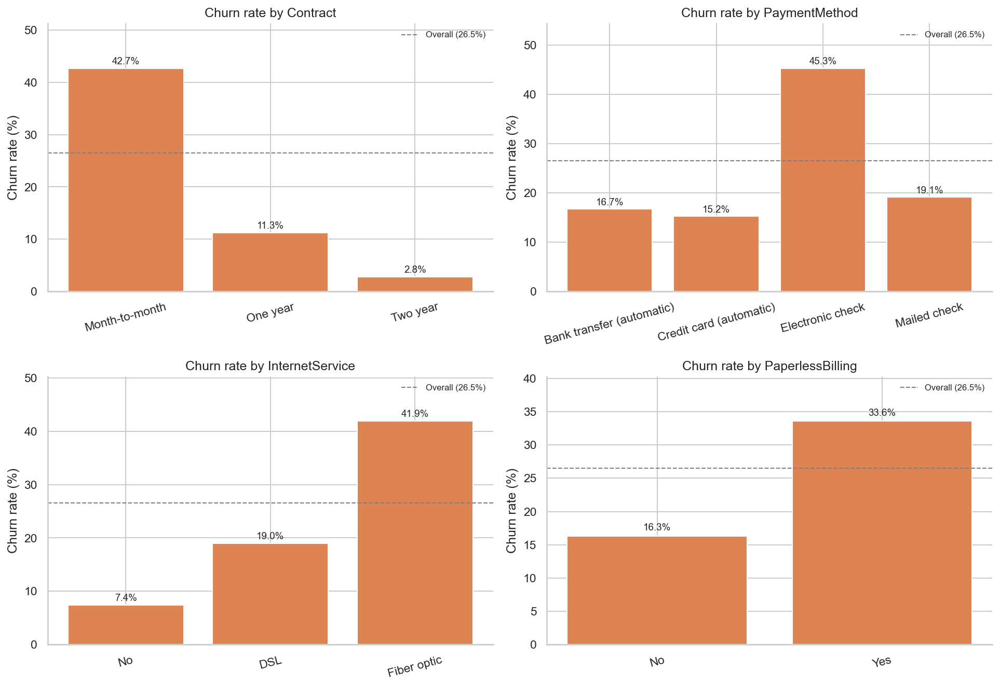
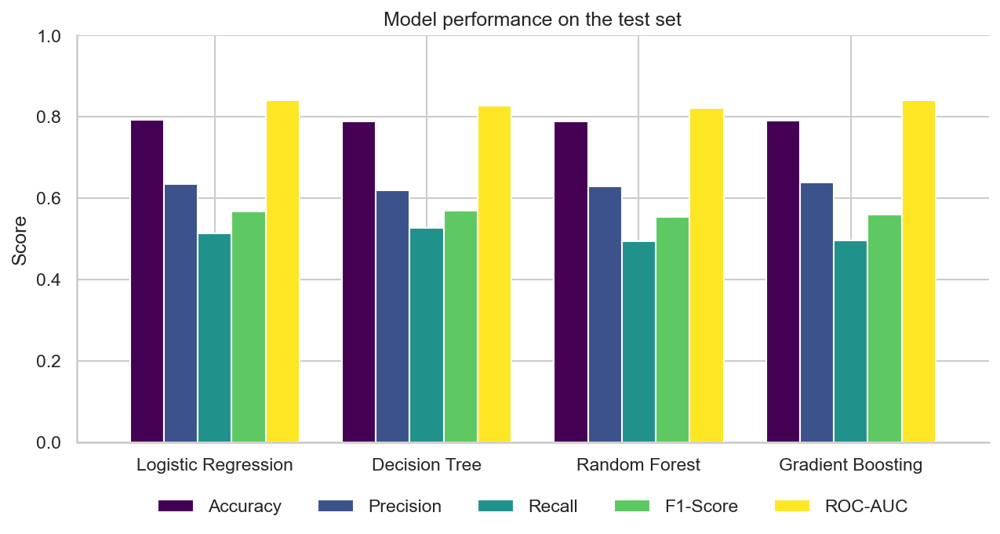
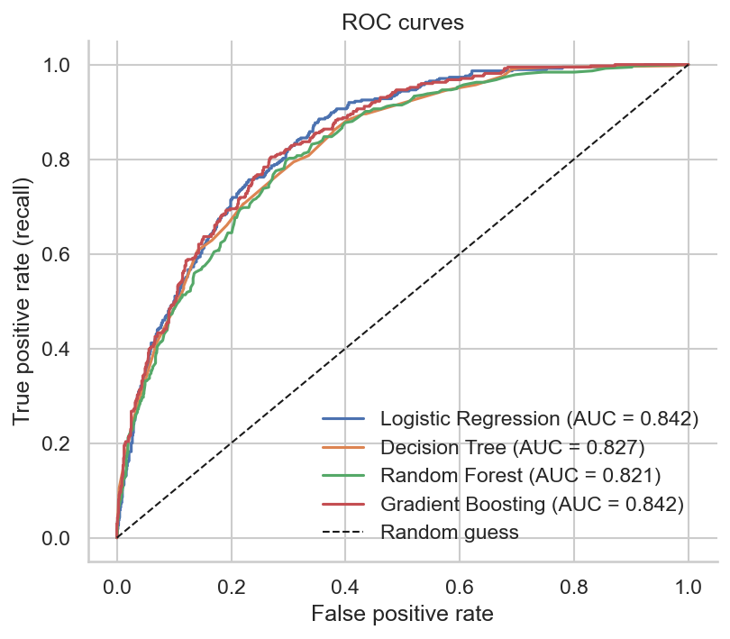
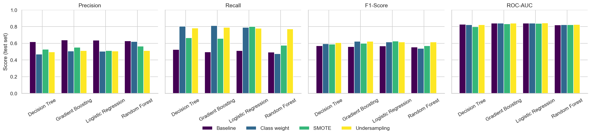

# Customer Churn Prediction

> Binary classification project that predicts whether a telecom customer is likely to churn.

**Note:** This repository is a rebuild of the Customer Churn Prediction project I developed during my Machine Learning internship at NexAfrica. I lost the original code, so I recreated the full workflow from scratch using the public Telco Customer Churn dataset, following the same steps: data preparation, EDA, feature engineering, classification models, class imbalance handling, optimization and interpretation.

## Project Overview
The goal of this project is to build a Machine Learning model that predicts whether a telecom customer is likely to leave the company (churn) or stay. It simulates a real-world business problem common in telecommunications, banking, insurance, subscription services and e-commerce.

- **Problem type:** supervised learning, binary classification
- **Target variable:** `Churn` (Yes / No)

## Business Problem
Acquiring a new customer is generally more expensive than retaining an existing one, so losing customers directly hurts recurring revenue. By predicting which customers are likely to churn, the company can intervene early with retention offers, contract improvements or proactive support.

> The objective of this project is to develop a Machine Learning classification model that predicts whether a customer is likely to churn based on demographic information, account details, subscription information, service usage, contract type, tenure, and billing information.

## Dataset
- **Source:** Telco Customer Churn (IBM sample data, also available on Kaggle)
- **Size:** 7,043 customers, 21 columns (19 features, 1 identifier, 1 target)
- **Raw data:** `data/raw_data/telco_churn.csv`
- **Cleaned data:** `data/processed_data/telco_churn_clean.csv`
- **Data dictionary:** [`docs/data_dictionary.md`](docs/data_dictionary.md)

### Data quality report
| Check | Result | Action |
|---|---|---|
| Missing values (`NaN`) | None | None needed |
| Blank strings in `TotalCharges` | 11 rows, all with `tenure = 0` (new customers) | Converted column to numeric, blanks set to `0` |
| Duplicate rows / customers | 0 | None needed |
| Inconsistent categories | Redundant `No internet service` / `No phone service` values; `SeniorCitizen` coded as 0/1 | Merged into `No`; converted to `No/Yes` |

### Target variable distribution
| Churn | Customers | Percentage |
|---|---|---|
| No | 5,174 | 73.46% |
| Yes | 1,869 | 26.54% |

The dataset is moderately imbalanced (about 2.8 : 1), so accuracy alone is not a reliable metric. Models are evaluated with Precision, Recall, F1-score and ROC-AUC.

## Tools and Technologies
Python, Pandas, NumPy, Matplotlib, Seaborn, Scikit-learn, XGBoost, imbalanced-learn, Jupyter Notebook.

## Project Workflow
Business Understanding → Data Collection → Data Cleaning → EDA → Feature Engineering → Model Training → Model Evaluation → Model Optimization → Feature Importance → Business Recommendations

## Exploratory Data Analysis
The EDA (section 5 of the notebook) includes 8+ visualizations saved in [`visuals/`](visuals/). Highlights:



### Key insights so far
1. **Contract type is the strongest driver:** month-to-month customers churn 42.7%, versus 11.3% (one year) and 2.8% (two year).
2. **New customers churn the most:** 47.4% churn in the first year, falling steadily with tenure.
3. **Higher bills, more churn:** customers paying $70-$90 per month churn about 38%, versus about 11% under $35.
4. **Electronic check users churn 45.3%**, about three times more than customers on automatic payments.
5. **Fiber optic customers churn 41.9%**, versus 19.0% for DSL and 7.4% without internet.
6. **Security and tech support services protect against churn** (about 15% vs 31% without them).
7. **Senior citizens** (41.7%) and customers without partner or dependents churn more; **gender has no effect**.

### Feature engineering
Seven features were created (`tenure_group`, `num_services`, `num_protection_services`, `has_streaming`, `spending_category`, `auto_payment`, `avg_monthly_spend`), `customerID`, `gender` and `PhoneService` were removed, and categorical variables were encoded. Details in [`docs/feature_engineering.md`](docs/feature_engineering.md). The machine-learning-ready dataset is `data/processed_data/telco_churn_ml_ready.csv` (7,043 rows, 31 features + target).

## Machine Learning Models
The data is split 80/20 with a **stratified** split (both sets keep the 26.5% churn rate) and four classification models are trained with untuned settings (section 8 of the notebook, code in `src/churn/modeling/`):

| Model | Role |
|---|---|
| Logistic Regression | Baseline (numeric features standardized inside its pipeline) |
| Decision Tree | `max_depth=5` |
| Random Forest | 200 trees |
| XGBoost | Falls back to sklearn's Gradient Boosting when XGBoost cannot be loaded |

To train and compare all models from the terminal:
```bash
PYTHONPATH=src python -m churn.modeling.split   # creates train.csv and test.csv
PYTHONPATH=src python -m churn.modeling.train   # prints the comparison table
```

## Evaluation Metrics
Because churn is the minority class, models are compared with Accuracy, Precision, Recall, F1-score and ROC-AUC (churn is the positive class), plus the train ROC-AUC to detect overfitting.

### Initial results (test set)
| Model | Accuracy | Precision | Recall | F1-Score | ROC-AUC |
|---|---|---|---|---|---|
| Logistic Regression | 0.793 | 0.636 | 0.513 | 0.568 | 0.842 |
| Decision Tree | 0.789 | 0.620 | 0.527 | 0.569 | 0.827 |
| Random Forest | 0.789 | 0.629 | 0.495 | 0.554 | 0.821 |
| Gradient Boosting | 0.792 | 0.639 | 0.497 | 0.559 | 0.842 |




- All models reach about 79% accuracy, only 6 points above the "always No churn" rule, so accuracy does not separate them.
- **Random Forest overfits** (train ROC-AUC about 1.00 vs 0.82 on test) and needs tuning.
- **All models catch only about half of the churners (recall 49% to 53%)**, the main weakness addressed in the next section.
- **Initial choice: Logistic Regression**: ties for the best ROC-AUC, does not overfit and is the most interpretable.

## Class Imbalance and Optimization
Churn is the minority class, so the models were re-trained with three strategies (class weights, SMOTE, undersampling), compared with 5-fold cross-validation and tuned with GridSearchCV / RandomizedSearchCV (section 10-12 of the notebook, code in `src/churn/modeling/`).



| Version | Precision | Recall | F1-Score | ROC-AUC |
|---|---|---|---|---|
| Logistic Regression, baseline | 0.636 | 0.513 | 0.568 | 0.842 |
| Logistic Regression, class weight | 0.504 | 0.791 | 0.616 | 0.842 |
| Gradient Boosting, class weight | 0.508 | 0.813 | 0.625 | 0.840 |
| **Random Forest, tuned + class weight** | 0.547 | **0.778** | **0.642** | **0.845** |

- Imbalance handling raises recall from about 50% to about 78-81% at the cost of precision; ROC-AUC does not change because the ranking of customers is the same.
- Tuning mostly helps Random Forest (F1 0.54 to 0.64, train ROC-AUC 1.00 to 0.91, less overfitting).
- **Selected model: tuned Random Forest with class weights**: it detects 291 of 374 churners in the test set. Full reasoning in [`docs/model_selection.md`](docs/model_selection.md).

## Key Findings
_Work in progress._

## Business Recommendations
_Work in progress._

## How to Run the Project
```bash
git clone <repo-url>
cd Customer-Churn-Prediction
python -m venv .venv
source .venv/bin/activate
pip install -r requirements.txt
jupyter notebook notebooks/customer_churn_analysis.ipynb
```

## Project Structure
```
Customer-Churn-Prediction/
├── data/
│   ├── raw_data/
│   └── processed_data/
├── docs/
│   ├── data_dictionary.md
│   ├── feature_engineering.md
│   └── model_selection.md
├── notebooks/
│   └── customer_churn_analysis.ipynb
├── src/churn/
│   ├── config.py
│   ├── data/            # loader.py, cleaning.py
│   ├── features/        # engineering.py, preprocessing.py
│   ├── modeling/        # split.py, train.py, evaluate.py, imbalance.py, validation.py, tuning.py
│   └── visualization/   # eda.py, model_plots.py
├── visuals/
├── README.md
└── requirements.txt
```
